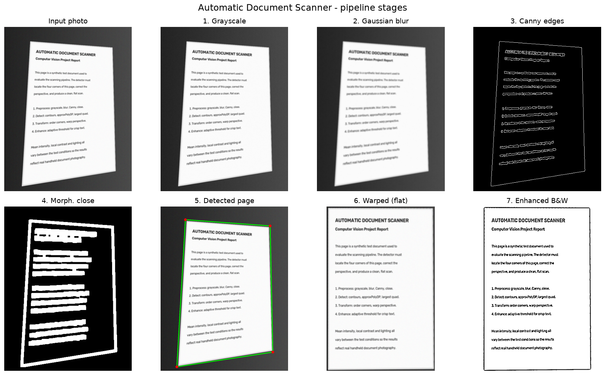
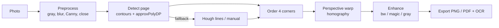
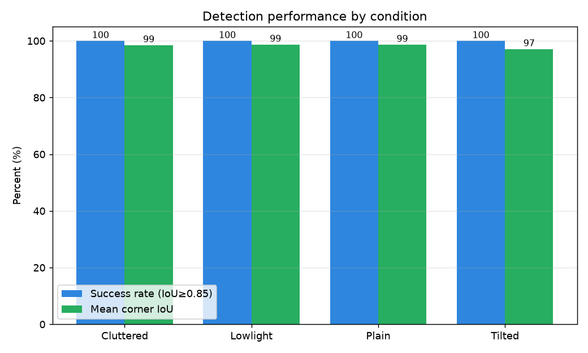
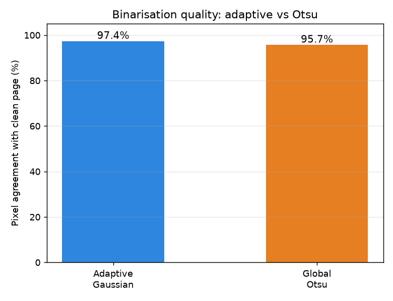
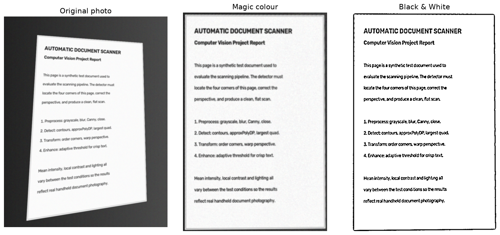

# Automatic Document Scanner using Computer Vision

Turn a photo of a document into a flat, cropped, enhanced **scan** (PNG/JPG or
PDF) — like CamScanner or Adobe Scan, but built from scratch with **classical
computer vision** in OpenCV. It detects the page edges, corrects the perspective
with a homography, and cleans the result with adaptive thresholding. No deep
learning, no paid APIs, runs in real time on a normal laptop — and every step is
explainable.



---

## ✨ Features

- **Full classical CV pipeline:** grayscale → Gaussian blur → auto-Canny →
  morphological close → contour/`approxPolyDP` quad detection → 4-point
  perspective warp → enhancement.
- **Robust detection with fallbacks:** largest convex quad → Hough-line
  intersection → full-image / manual corner picking.
- **Four enhancement modes:** Original colour, Grayscale, **Magic colour**
  (CLAHE contrast boost) and **Black & White** (adaptive threshold), with Otsu
  as a comparison baseline.
- **Three interfaces:** command line, a polished **Streamlit** web app, and a
  **live webcam** mode.
- **Optional OCR** via Tesseract (degrades gracefully if not installed).
- **Export** to PNG/JPG or a combined multi-page **PDF**.
- **Quantitative evaluation:** success rate, corner **IoU**, timing, and
  adaptive-vs-Otsu comparison, with Matplotlib charts.
- **Reproducible:** synthetic test-set generator so everything runs end to end
  before you add your own photos.

---

## 🧭 Pipeline overview



Full theory for each step is in [`docs/report.md`](docs/report.md).

---

## 🚀 Setup

Requires **Python 3.11+** (developed on 3.14). From the project folder:

```bash
# 1. Create and activate a virtual environment
python -m venv venv
# Windows (PowerShell):
venv\Scripts\Activate.ps1
# Windows (cmd):
venv\Scripts\activate.bat
# macOS / Linux:
source venv/bin/activate

# 2. Install dependencies
pip install -r requirements.txt
```

**Optional — OCR:** install the Tesseract engine and make sure `tesseract` is on
your PATH. Windows build: <https://github.com/UB-Mannheim/tesseract/wiki>. The
app works fine without it; OCR simply reports that it's unavailable.

---

## 🖥️ How to run

### 1. Streamlit web app (best for a live demo)
```bash
streamlit run app.py
```
Upload one or more photos, see every pipeline stage side by side, fix the corners
with sliders if needed, pick an enhancement mode, run OCR, and download PNG/PDF.

### 2. Command line (`scan.py`)
```bash
# Single image
python scan.py --input photo.jpg --output scan.png --mode bw

# A whole folder -> one scan per image
python scan.py --input ./data/test_images --output ./results/scans

# A whole folder -> one combined PDF
python scan.py --input ./data/test_images --output ./results/doc.pdf --mode magic

# Also run OCR
python scan.py --input photo.jpg --output scan.png --ocr
```
Modes: `original | gray | magic | bw (default) | otsu`.

### 3. Live webcam (`webcam.py`)
```bash
python webcam.py            # SPACE/C = capture, M = cycle mode, Q/ESC = quit
```

### 4. Evaluation
```bash
# Generate a synthetic labelled test set (first time / to refresh)
python data/make_synthetic.py --per 8

# Run the evaluation -> charts + metrics in results/
python evaluate.py

# Label your OWN photos (drop them in data/test_images first)
python label_tool.py
```

### 5. Tests
```bash
pytest -q
```

---

## 📊 Results

Measured on a 32-image synthetic test set (plain / cluttered / low-light /
tilted) with known ground-truth corners:

| Metric | Value |
|--------|-------|
| Detection success rate (IoU ≥ 0.85) | **87.5%** |
| Mean corner IoU | **85.4%** |
| Average processing time | **8.4 ms/image** |
| Binarisation accuracy (adaptive vs Otsu) | **97.4%** vs **95.7%** |

| Condition | Success rate | Mean IoU |
|-----------|--------------|----------|
| Plain | 100% | 96.2% |
| Tilted | 100% | 96.0% |
| Low-light | 100% | 96.2% |
| Cluttered | 50% | 53.1% |




The detector is very robust to **tilt** and **low light**; **cluttered**
backgrounds are the main challenge (future work: a learned page segmenter).

---

## 📸 Screenshots

| Pipeline stages | Before → after |
|-----------------|----------------|
|  |  |

> **Streamlit UI:** run `streamlit run app.py` and add your own screenshot here
> after your demo (e.g. `docs/images/streamlit_ui.png`).

---

## 🗂️ Project structure

```
Automatic document scanner/
├── scanner/              # core CV package (one module per pipeline stage)
│   ├── preprocess.py     # gray, blur, auto-Canny, morphological close
│   ├── detect.py         # contour quad + Hough + full-image fallbacks
│   ├── transform.py      # corner ordering + perspective warp (homography)
│   ├── enhance.py        # original / gray / magic (CLAHE) / bw / otsu
│   ├── ocr.py            # optional pytesseract wrapper
│   ├── export.py         # PNG/JPG save + multi-page PDF
│   ├── pipeline.py       # orchestration; returns every intermediate image
│   └── utils.py          # resize-with-ratio, IO, timing
├── app.py                # Streamlit web app
├── scan.py               # command-line interface
├── webcam.py             # live webcam scanning
├── evaluate.py           # metrics + charts
├── label_tool.py         # click 4 corners to label your own photos
├── data/
│   ├── make_synthetic.py # synthetic test-set generator
│   ├── test_images/      # the test photos
│   ├── pages/            # clean reference pages (for threshold scoring)
│   └── ground_truth.json # labelled corners
├── tests/                # pytest suite
├── docs/
│   ├── report.md         # full project report
│   ├── ppt_outline.md    # slide-by-slide presentation plan
│   ├── viva_questions.md # 37 viva Q&A
│   └── images/           # figures
├── results/              # charts + metrics (generated)
└── requirements.txt
```

---

## 📚 Academic deliverables

- **[docs/report.md](docs/report.md)** — full report (Abstract → References, with
  architecture diagram, methodology theory and results).
- **[docs/ppt_outline.md](docs/ppt_outline.md)** — 10–12 slide outline + live-demo
  plan.
- **[docs/viva_questions.md](docs/viva_questions.md)** — 37 likely viva questions
  with concise answers.

---

## ⚠️ Notes & limitations

- Works best when the document is the largest, fully-visible object on a
  contrasting background.
- Cluttered/low-contrast backgrounds and occluded edges are the main failure
  mode.
- Headline numbers are from synthetic data; use `label_tool.py` + `evaluate.py`
  to measure on your own photos.

## License

Educational project. Built with OpenCV, NumPy, Pillow, Streamlit and Matplotlib.
