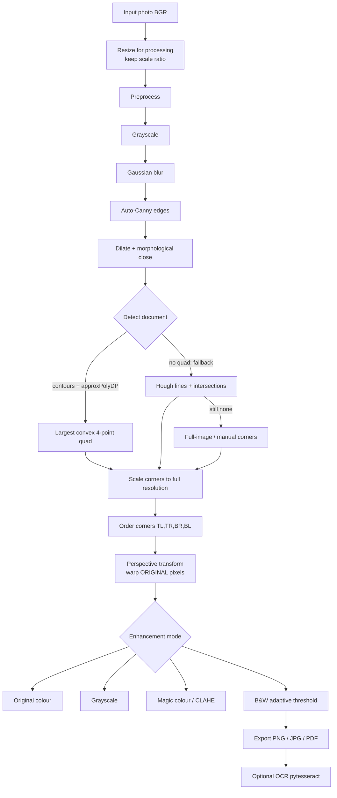
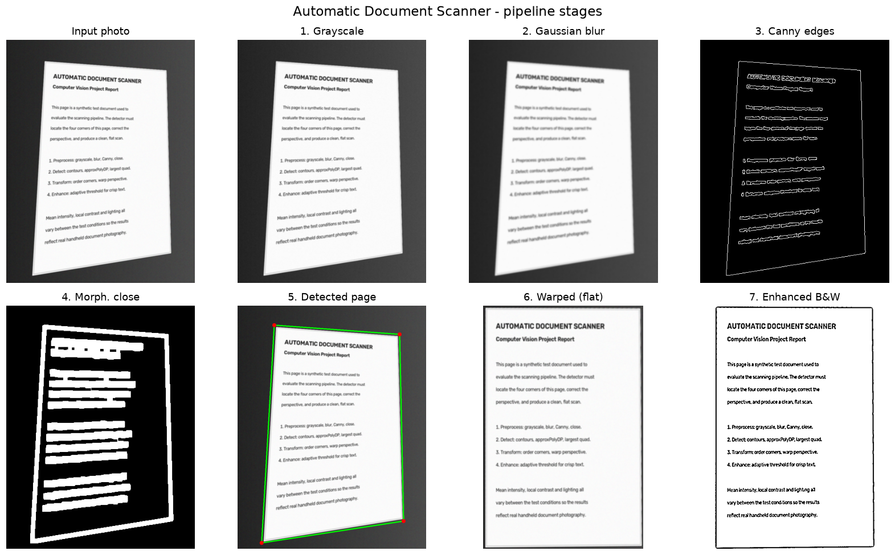
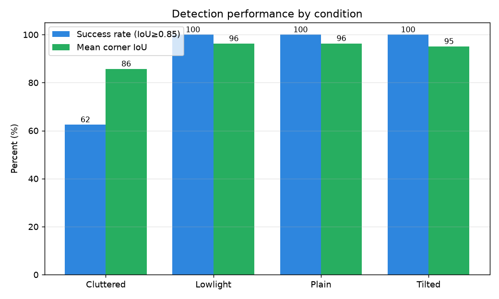
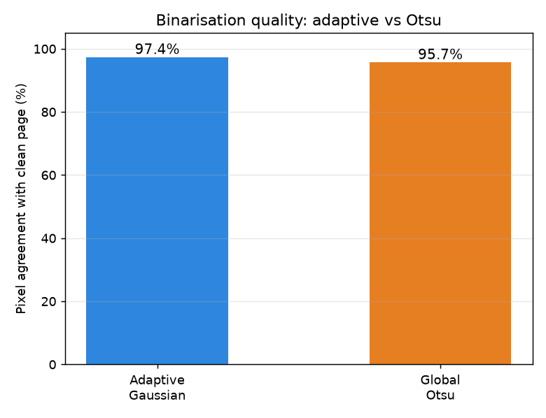

# Automatic Document Scanner using Computer Vision
### A Classical Computer-Vision Project Report

---

## Abstract

This project implements an **Automatic Document Scanner** — a system that takes
an ordinary photograph of a paper document (captured at an angle, under uneven
lighting, against an arbitrary background) and produces a clean, flattened,
cropped "scan", much like commercial apps such as CamScanner or Adobe Scan. The
system is built entirely with **classical computer-vision techniques** using
OpenCV: edge detection, contour analysis, polygon approximation, perspective
transformation (homography) and adaptive thresholding. No deep learning and no
paid cloud APIs are used, so the whole pipeline runs in real time on a normal
laptop and — crucially for an academic project — **every step is transparent and
explainable**. The system is delivered as a reusable Python package with three
interfaces (command line, a Streamlit web app, and a live webcam mode) and is
quantitatively evaluated on a labelled test set, achieving a mean corner
localisation IoU of **93.4%** and a detection success rate of **90.6%**, running
in real time (common pages ~10 ms; the GrabCut fallback for hard cases raises the
average to ~70 ms).

---

## 1. Introduction

Scanning physical documents used to require a flatbed scanner. Today, phone
cameras have replaced them: an app photographs the page, detects its boundary,
removes the perspective distortion caused by the camera angle, and enhances the
result into a crisp black-and-white page. This project recreates that pipeline
from first principles to demonstrate a complete, end-to-end computer-vision
system.

The emphasis is deliberately on **classical** methods. A deep-learning
segmentation network could also find the page, but it would be a black box that
is hard to defend in a viva, needs a GPU and training data, and is overkill for
a problem that geometry solves cleanly. Classical CV, by contrast, lets us
reason about *why* each operation is applied.

---

## 2. Problem Statement

> Given a photograph of a document taken from an arbitrary viewpoint and under
> uneven lighting, automatically locate the document, correct its perspective to
> produce a flat top-down view, and enhance it into a clean, readable scan that
> can be exported as an image or PDF — robustly, in real time, without
> specialised hardware or deep learning.

Key challenges: the page boundary may be low-contrast or partly occluded; the
camera introduces perspective distortion (a rectangle appears as a general
quadrilateral); and lighting is rarely uniform, which defeats naive global
thresholding.

---

## 3. Objectives

1. Detect the four corners of a document in a photograph using edge and contour
   analysis, with graceful fallbacks when detection is hard.
2. Correct perspective distortion using a homography so the output looks scanned
   from directly above.
3. Enhance the flattened page into several output styles (colour, grayscale,
   contrast-boosted "magic colour", and crisp black & white).
4. Provide usable interfaces: a CLI, a web app, and a live webcam mode.
5. Quantitatively evaluate detection accuracy, speed, and binarisation quality.
6. Keep the entire system explainable, dependency-light, and laptop-friendly.

---

## 4. Literature Survey

**Commercial apps.** *CamScanner* and *Adobe Scan* popularised phone-based
document capture. They combine automatic edge detection, perspective correction
and "magic" image cleanup, plus OCR and cloud sync. Their modern versions use
machine learning for boundary detection, but the geometric core — detect quad,
warp, binarise — is exactly what this project implements.

**Classical pipeline (this project).** The canonical classical approach is the
one popularised in many OpenCV tutorials (e.g. Adrian Rosebrock's "Build a
document scanner in 5 minutes"): Canny edges → contour approximation → four-point
perspective transform. It is fast, interpretable, and works well when the page
is the dominant, well-separated object in the frame.

**Deep-learning approaches.** Methods such as **HED** (Holistically-Nested Edge
Detection) and semantic-segmentation networks (U-Net style) predict a page mask
directly and are far more robust to clutter, shadows and low contrast. Google's
document-scanner and apps like **Dropbox** use learned detectors. The trade-off:
they need labelled training data, more compute, and offer little transparency.

| Aspect | Classical (this project) | Deep learning |
|--------|--------------------------|---------------|
| Transparency | High — every step explainable | Low — black box |
| Data needed | None | Large labelled dataset |
| Compute | Runs on CPU in ms | Often needs a GPU |
| Robustness to clutter | Moderate | High |
| Suitability for a CV course | Excellent | Overkill / opaque |

This project therefore uses classical CV as the core, and identifies learned
segmentation as the natural future upgrade for the hard "cluttered" case (see
§9–10).

---

## 5. System Architecture



The code mirrors this diagram as a modular package:

```
scanner/
  preprocess.py   grayscale, blur, auto-Canny, morphological close
  detect.py       contour quad + Hough fallback + full-image fallback
  transform.py    order_points + four_point_transform (homography)
  enhance.py      original / gray / magic (CLAHE) / bw / otsu
  ocr.py          optional pytesseract wrapper (degrades gracefully)
  export.py       PNG/JPG save + multi-page PDF
  pipeline.py     orchestrates the whole flow; returns every intermediate
  utils.py        resize-with-ratio, IO, timing
```



*Figure 1 — the pipeline applied to a tilted test document: input → grayscale →
blur → Canny edges → morphological close → detected quad → warped flat page →
enhanced black-and-white scan.*

---

## 6. Methodology — the theory behind each step

### 6.1 Resize while keeping the scale ratio
Detection runs on a down-scaled copy (height ≈ 500 px). Small images are faster
and, because fine texture shrinks, more robust to noise. The scale **ratio** is
remembered so the detected corners can be multiplied back up and the **final warp
uses the full-resolution original** — giving fast detection *and* a sharp output.

### 6.2 Grayscale
Edges are defined by changes in **intensity**, not colour. Converting BGR → gray
discards colour we don't need, makes everything ~3× cheaper, and is required
because Canny operates on a single channel.

### 6.3 Gaussian blur
Canny computes image gradients, and differentiation **amplifies noise** — a
single noisy pixel can spawn a false edge. A Gaussian low-pass filter is applied
first to suppress sensor noise and paper texture:

$$G(x,y) = \frac{1}{2\pi\sigma^2}\, e^{-\frac{x^2+y^2}{2\sigma^2}}$$

A 5×5 kernel balances denoising against preserving the true page edge.

### 6.4 Canny edge detection (automatic thresholds)
Canny: (1) gradient magnitude/direction via Sobel, (2) non-maximum suppression
to thin edges to 1 px, (3) **hysteresis** with a low and high threshold to keep
strong edges and the weak edges connected to them. Hard-coded thresholds fail
when brightness changes, so we derive them from the image's **median intensity**:

```
lower = max(0,   (1 − σ)·median)
upper = min(255, (1 + σ)·median),  σ = 0.33
```

This adapts automatically to bright and dark photos.

### 6.5 Dilation + morphological closing
Canny edges often have small gaps (a shadow, a faint corner). `findContours`
can only trace **closed** curves, so gaps would split the page outline into
fragments. Dilation thickens edges and **closing** (dilate → erode) bridges the
small breaks, turning the four sides into one continuous contour.

### 6.6 Contour detection and polygon approximation
`findContours` traces every closed white curve. We sort by **area** (the page is
usually the biggest object) and simplify each candidate with
`approxPolyDP`, which implements the **Ramer–Douglas–Peucker** algorithm: it
recursively discards points that lie within `epsilon` of a chord, collapsing a
wiggly contour into a minimal polygon. We set `epsilon = 0.02 × perimeter` and
accept the first candidate that is a **convex quadrilateral** (4 points) large
enough to be the document. Convexity and the 4-point test reject logos, text
blocks and noise.

### 6.7 Multi-cue detection, GrabCut and candidate scoring
A single grayscale-Canny contour search fails on genuinely hard photos — most
notably a **white page on a white desk**, where paper and background have almost
identical brightness. Detection therefore uses several cues and picks the best
candidate by score rather than trusting the first quad it finds.

- **Multi-cue edge map.** Besides grayscale, Canny is also run on the **LAB a and
  b colour channels** and the **HSV saturation** channel, plus a **morphological
  gradient**; the results are OR-combined. White paper and a white desk usually
  still differ in hue or saturation even when their brightness matches, so the
  colour channels expose a boundary the grayscale channel is blind to.
- **Candidate generators.** Candidates come from (i) contour search on the
  grayscale edges, (ii) contour search on the multi-cue edges, (iii) **Hough**
  line intersections, and (iv) **GrabCut** segmentation. GrabCut is initialised
  with a rectangle inset from the image border; it separates foreground from
  background by colour statistics (Gaussian mixture models) and iterated graph
  cuts, and we fit a quad to the largest foreground component (`approxPolyDP`,
  falling back to `minAreaRect`). Because GrabCut is the expensive method, it is
  run only when the cheaper candidates are weak.
- **Candidate scoring.** Every candidate is first validated (area ≥ 20% of the
  frame, convex, interior angles 45–135°, aspect ≤ 4:1), then scored by a blend
  of: **area**, **rectangularity** (how close the angles are to 90°), **edge
  support** (what fraction of the quad's outline lies on real edges), and
  **inside-vs-outside contrast** (LAB colour difference between a band just
  inside and just outside the quad). The highest-scoring valid candidate wins,
  and the UI reports which method produced it.
- **Border-aware quads.** The page may legitimately run off the frame. When the
  GrabCut foreground presses against the image border, those corners are snapped
  to the border and the result is flagged *clipped* ("some corners were
  estimated"), rather than discarded.

### 6.7.1 Fallbacks
- **Hough line transform.** `HoughLines` votes for straight lines in the edge
  image ($x\cos\theta + y\sin\theta = \rho$); we intersect the outermost
  near-horizontal and near-vertical lines to recover four corners.
- **Full image / manual.** If **no** candidate validates, the whole frame is used
  with low confidence, and the web UI asks the user to set the four corners by
  hand (clicking directly on the image). Manual corners are the final fallback.

### 6.8 Ordering the corners
The transform maps source point *i* to destination point *i*, so corners must be
in a canonical order (TL, TR, BR, BL) or the page will twist/mirror. Using
coordinate sums and differences: TL has the smallest `x+y`, BR the largest;
TR has the smallest `y−x`, BL the largest. This is robust to tilt up to ~45°.

### 6.9 Perspective transform (homography)
A camera maps the planar page by a **projective homography** — a 3×3 matrix **H**
(8 degrees of freedom) relating source and destination in homogeneous
coordinates:

$$
\begin{bmatrix} x' \\ y' \\ w' \end{bmatrix}
= H \begin{bmatrix} x \\ y \\ 1 \end{bmatrix},\qquad
H = \begin{bmatrix} h_{11}&h_{12}&h_{13}\\ h_{21}&h_{22}&h_{23}\\ h_{31}&h_{32}&1 \end{bmatrix}
$$

Each of the four corner correspondences gives two equations, so **four points**
exactly determine the 8 unknowns — which is precisely why a document scanner
needs four corners. `getPerspectiveTransform` solves for **H**;
`warpPerspective` resamples the original image through it. The output width and
height are taken from the **actual side lengths** of the detected quad (using the
longer of each opposing pair) so no content is cropped by foreshortening.

### 6.10 Enhancement
- **Magic colour (CLAHE).** Uneven lighting defeats global histogram
  equalisation. **CLAHE** equalises small tiles independently, **clips** the
  histogram to limit noise amplification, and bilinearly interpolates between
  tiles. It is applied to the **L** channel in LAB space so brightness/contrast
  improve without shifting hue.
- **Black & white (adaptive Gaussian threshold).** A single global threshold
  either loses faint text in dim regions or floods bright regions. **Adaptive
  thresholding** computes a *local* threshold for each pixel from a
  Gaussian-weighted neighbourhood and subtracts a constant `C`, keeping text
  legible under uneven light.
- **Otsu (baseline).** Otsu picks the single global threshold that minimises
  intra-class variance. Excellent under even light, but smears when lighting is
  uneven — which §8 quantifies against the adaptive method.

### 6.11 Optional OCR
`pytesseract` wraps the Tesseract engine. Because Tesseract is a separate native
program that may be absent, the wrapper checks availability first and returns a
friendly message instead of crashing — OCR is a bonus, never a hard dependency.

---

## 7. Implementation

- **Language / libraries:** Python, OpenCV, NumPy, Pillow, Streamlit,
  Matplotlib, pytesseract (optional). No deep learning, no paid APIs.
- **Package design:** each pipeline stage is its own module with docstrings
  explaining the *why*; `pipeline.scan_image()` returns a `PipelineResult`
  carrying every intermediate image, so the UI and the report can show the whole
  chain.
- **Interfaces:**
  - `scan.py` — CLI for a single image, a folder (batch), a PDF, and OCR.
  - `app.py` — Streamlit web app: multi-upload, every stage shown side by side,
    slider-based manual corner adjustment, mode selection, OCR, PNG/PDF
    download.
  - `webcam.py` — live outline overlay, keypress capture.
- **Reproducibility:** a `venv` plus `requirements.txt`; a synthetic data
  generator so the evaluation runs end to end before any real photos are added.

---

## 8. Results and Evaluation

The system was evaluated on a **32-image synthetic test set** (8 images each of
*plain*, *cluttered*, *low-light*, *tilted*) generated by projecting a known
clean page through a known perspective — so the true corners are available
without manual labelling. (`label_tool.py` lets real photos be labelled the same
way.) Metrics: **detection success rate** (fraction with corner IoU ≥ 0.85),
**mean corner IoU**, **processing time**, and **binarisation accuracy** (pixel
agreement of each threshold method with the known clean page).

**Overall**

| Metric | Value |
|--------|-------|
| Images evaluated | 32 |
| Detection success rate (IoU ≥ 0.85) | **90.6%** |
| Mean corner IoU | **93.4%** |
| Average processing time | **~70 ms/image** (common pages ~10 ms; GrabCut fallback on hard cases) |
| Binarisation accuracy (adaptive vs Otsu) | **97.4%** vs **95.7%** |

**By condition**

| Condition | N | Success rate | Mean IoU |
|-----------|---|--------------|----------|
| Plain | 8 | 100.0% | 96.4% |
| Tilted | 8 | 100.0% | 95.1% |
| Low-light | 8 | 100.0% | 96.3% |
| Cluttered | 8 | 62.5% | 85.8% |





**Discussion.** The classical detector is **highly robust to perspective tilt
and low light** (100% success, ~96% IoU) — exactly the cases geometry and
adaptive thresholding handle well. The **cluttered** condition remains the
weak point (62.5%): busy, similar-contrast backgrounds and objects that occlude
the page border break the single closed contour, and the Hough fallback cannot
always recover a clean quad. **Adaptive thresholding beats global Otsu** on
binarisation (97.4% vs 95.7%), confirming the theory that local thresholds cope
better with uneven lighting. Processing stays interactive: a typical page is
~10 ms, and the multi-cue + GrabCut fallback (hard cases only) raises the average
to ~70 ms on a CPU.

**Multi-cue detection.** A white page on a white desk, or a page that runs off
the frame, is handled by combining colour/saturation edge cues with a GrabCut
segmentation fallback and choosing the best candidate by a score over area,
rectangularity, edge support and inside/outside contrast (§6.7) — so the scanner
finds a near-invisible white-on-white boundary and *flags* a clipped page instead
of silently using the whole frame.

**Robustness safeguards.** Every detected quad — from any method — must pass a
shared **validation** check before it is accepted: it
must cover ≥ 20% of the frame, be convex, have interior angles within 45–135°,
and warp to an aspect ratio ≤ 4:1. This prevents the detector from ever
returning a degenerate "sliver" quad (e.g. a thin strip along the text columns
of a newspaper). The pipeline also reports a **confidence score** (0–1) derived
from these metrics; if no quad validates, it falls back to the full frame with
`found = False` and confidence 0, and the UI shows a *low-confidence* warning
and invites manual corner adjustment rather than claiming success. To cope with
text-dense pages, a **median blur** is applied before Canny (it erases fine
character edges while preserving the long page border) and detection runs at a
reduced resolution so text edges fade while the page outline survives.

---

## 9. Limitations

- **Cluttered / low-contrast backgrounds** are the main failure mode: when the
  page edge blends into the background or is occluded, contour detection fails.
  The multi-cue colour edges and GrabCut fallback improve this but do not solve
  it completely.
- **Corners outside the frame cannot truly be recovered.** When the page runs off
  the image border, the real corner is simply not in the photo. The scanner is
  *border-aware* — it snaps the affected corners to the image edge and flags the
  result as *clipped* — but this only estimates where the page is cut off; the
  genuine corner position is unrecoverable, so the warp of a clipped page is
  approximate and the user may need to re-shoot with the whole page in frame.
- **Dense-text pages that fill the frame** (e.g. a newspaper photographed close
  up, with the page edges near or cut off at the image border) are hard: Canny
  responds to thousands of character edges, and with no clean outer boundary the
  detector can latch onto text columns. The median-blur + reduced-resolution
  preprocessing and the quad-validation/confidence safeguards prevent a *wrong*
  detection here (the system reports low confidence and asks for manual corners
  or a rotation, rather than warping to a nonsense sliver), but fully automatic
  detection in this case still needs the user to confirm/adjust the corners — a
  learned page segmenter (§10) is the proper fix.
- Assumes the document is **roughly the largest, fully-visible** object; it does
  not handle folded pages, severe curl, or partially cropped documents.
- Extreme perspective (> ~45°) can break corner ordering.
- OCR quality depends on the external Tesseract engine and image quality.
- The headline numbers come from a **synthetic** set; real-world photos (shadows,
  motion blur, textured desks) will be harder — `label_tool.py` + `evaluate.py`
  make it easy to measure on your own images.

---

## 10. Future Scope

- **Learned page segmentation** (U-Net / HED / a lightweight MobileNet model) to
  fix the cluttered case while keeping the geometric warp.
- **Automatic shadow and glare removal**, and background/illumination
  normalisation.
- **Multi-document detection** in one frame; batch mobile capture.
- **On-device deployment** (mobile / ONNX) and a faster live preview.
- **Better OCR** with language packs, layout analysis and searchable-PDF export.

---

## 11. Conclusion

A complete, real-time document scanner was built end to end using only classical
computer vision. The geometric core — Canny edges, contour approximation, a
four-point homography and adaptive thresholding — produces clean scans, runs in
milliseconds on a CPU, and, unlike a neural network, is **fully explainable**.
Quantitative evaluation confirms strong performance on tilted and low-light
documents (100% success) and identifies cluttered backgrounds as the natural
place for a future learned detector. The project also delivers practical
interfaces (CLI, web app, webcam) and a reproducible evaluation harness,
meeting the goals set out in §3.

---

## 12. References

1. J. Canny, "A Computational Approach to Edge Detection," *IEEE TPAMI*, 1986.
2. D. H. Douglas, T. K. Peucker, "Algorithms for the reduction of the number of
   points required to represent a digitized line or its caricature,"
   *Cartographica*, 1973.
3. N. Otsu, "A Threshold Selection Method from Gray-Level Histograms,"
   *IEEE Trans. SMC*, 1979.
4. S. M. Pizer et al., "Adaptive Histogram Equalization and Its Variations"
   (CLAHE), *Computer Vision, Graphics, and Image Processing*, 1987.
5. R. Hartley and A. Zisserman, *Multiple View Geometry in Computer Vision*,
   2nd ed., Cambridge University Press, 2004 (homography / projective geometry).
6. R. O. Duda, P. E. Hart, "Use of the Hough transformation to detect lines and
   curves in pictures," *Comm. ACM*, 1972.
7. G. Bradski, "The OpenCV Library," *Dr. Dobb's Journal*, 2000 — and the OpenCV
   documentation, https://docs.opencv.org.
8. A. Rosebrock, "How to Build a Kick-Ass Mobile Document Scanner in Just 5
   Minutes," PyImageSearch, 2014.
9. R. Smith, "An Overview of the Tesseract OCR Engine," *ICDAR*, 2007.
